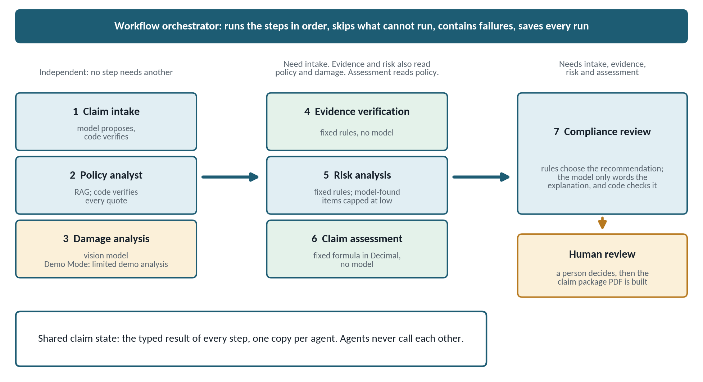
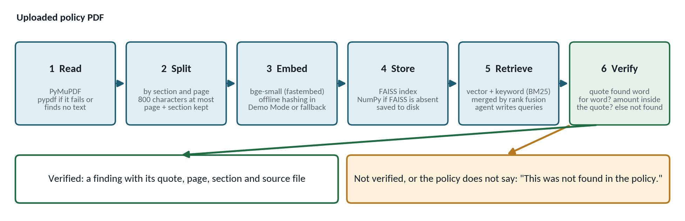
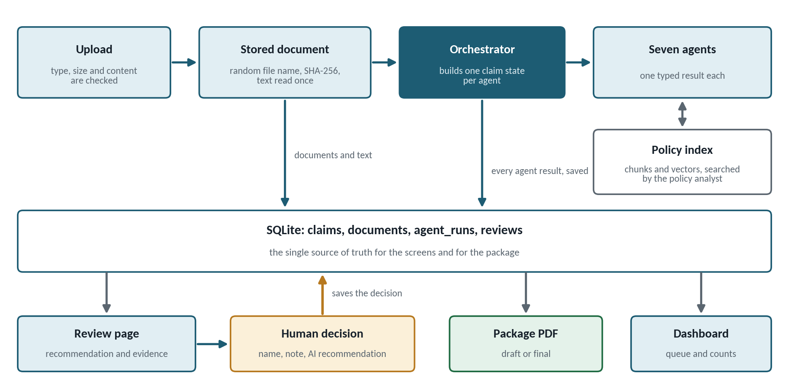
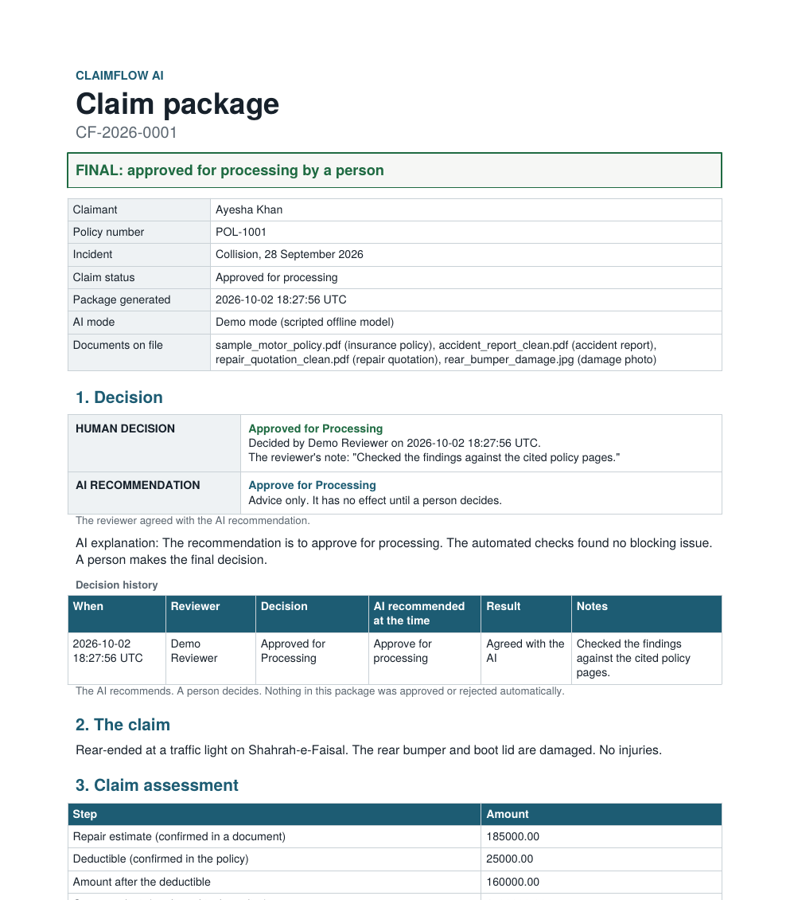

# ClaimFlow AI: Final Product Requirements Document

*Multi-agent insurance claim verification with a human in the loop*

| Item | Detail |
| --- | --- |
| **Product** | ClaimFlow AI |
| **Version** | 1.0, final (hackathon MVP) |
| **Date** | 2 October 2026 |
| **Scope** | Motor insurance claims: collision, theft, fire, weather or natural disaster, vandalism, other |
| **Team** | [add team names] |
| **Basis** | This document describes the application as built. Work that is not built appears only under Limitations and Future scope. |

## 1. Problem

A motor insurance claim arrives as a form and a set of documents: the policy PDF, an accident report, a repair quotation and damage photos. Before a person can decide, the reviewer has to answer four questions.

1. Is this kind of loss covered, and what are the deductible and the limit?
2. Is the required evidence attached and readable?
3. Do the documents agree with each other?
4. How much could be paid?

A reviewer answers these by reading each file, searching a long policy for the right clause, comparing details by eye and doing the arithmetic by hand. This is general domain knowledge. The team did not run a time study, so this document makes no claim about hours saved.

### Where manual review goes wrong

- Missing or unreadable documents are noticed late.
- The right clause is hard to find, and the excess often differs by claim type.
- Mismatches between the form, the report and the quotation are easy to miss.
- The reasoning behind a decision is rarely recorded in one place.

### Why a plain chat model is not enough

A chat model asked to review a claim can invent a policy clause, miscalculate an amount, accuse a claimant of dishonesty, follow instructions hidden in an uploaded file, or make the decision itself. None of these is acceptable in this process.

> Problem statement: prepare a claim file faster and more consistently, without letting a model invent policy terms, do the arithmetic, or make the decision.

## 2. Solution

ClaimFlow AI is a Streamlit web application. Seven agents prepare a claim file, and a person decides. For each claim the system produces:

- structured claim facts read from the documents
- policy findings (cover, deductible, limit, exclusions), each with a quote, page and section
- an evidence checklist and consistency checks
- risk indicators for a person to look at, never judgements about anyone's honesty
- a potential claim amount calculated in code, with its working
- a recommendation with an explanation, and a recorded human decision
- a claim package PDF with an audit trail of every agent step

### Design principles

1. Models propose, code verifies. Every figure, date and quote a model supplies is checked against the source text before it is used.
2. Money comes from code. The potential claim amount is calculated with exact decimal arithmetic. A model never supplies a number that code trusts.
3. Cite it or say it was not found. A policy statement is shown only with a quote found word for word on the cited page.
4. A person decides. The AI recommends. Nothing is approved, rejected or escalated by an agent.
5. Degrade, do not crash. A failing step is shown as failed or skipped with a reason, and the claim still reaches a person.

### Two modes

Live AI sends model requests to a configured provider (Gemini, Groq or OpenRouter). Demo Mode runs the whole workflow offline with a scripted model, so a demonstration cannot be broken by a network or rate-limit problem. Demo Mode is labelled wherever it is active, and its damage description is labelled as limited demo analysis because it does not interpret images.

## 3. Goals

| ID | Goal | How it is met |
| --- | --- | --- |
| G1 | Cover the whole review path in one workflow | Intake, policy, damage, evidence, risk, assessment and compliance run from one action. A person then reviews and a package PDF is produced. |
| G2 | Ground every policy statement | Findings and answers exist only with a quote verified word for word against the cited chunk. Otherwise the result is "not found". |
| G3 | Keep money deterministic | The amount is calculated by a fixed formula in Decimal. The assessment step makes no model call. |
| G4 | Keep a person in control | Only a person records a decision. Deciding differently from the AI needs a written reason. The AI recommendation is stored with the decision. |
| G5 | Be resilient | A crash or failure becomes a visible failed or skipped step. Demo Mode runs with no network. |
| G6 | Be auditable | Every agent run is saved. The package PDF lists each step, its status, time and model. |
| G7 | Stay cheap to run | At most six model calls per claim. |

### Non-goals

- Automatic approval or rejection of claims.
- Fraud detection. The system lists risk indicators and inconsistencies. It never says that a person committed fraud.
- Payment, settlement or integration with a claims system.
- Professional damage assessment or repair costing.
- OCR of scanned documents.
- A multi-user production system with accounts and roles.

## 4. Target users

These users are assumed from the problem domain. The team did not run user interviews.

| User | Needs | How ClaimFlow AI helps |
| --- | --- | --- |
| Claims reviewer or adjuster (primary) | A prepared file: facts, policy terms, missing items, an amount and a recommendation to check. | One run produces all of it, with sources. The reviewer records the decision on the Review page. |
| Claims team lead | To see what is waiting and what was escalated. | The dashboard shows claims by status and the review queue. |
| Compliance or audit reviewer | To see why a decision was made. | The package PDF shows the decision beside the AI recommendation, the working, the citations and the audit trail. |
| Demonstrator or evaluator | A reliable way to see the workflow. | Demo Mode, three demo claims and sample files run with no key and no internet. |

## 5. User stories

| ID | Story | Acceptance criteria |
| --- | --- | --- |
| US-1 | As a reviewer I can create a claim and attach documents. | The form reports every problem at once. Only PDF, PNG and JPG are accepted, within the size limit, and a file whose content does not match its type is refused with a reason. |
| US-2 | As a reviewer I can run all agents with one action and watch each step. | A live trace shows each step. Each ends as done, warning, failed or skipped, with a reason. |
| US-3 | As a reviewer I can see what the policy says about this claim. | Each finding shows value, quote, page, section and file, with a link to the source page. A topic the policy does not answer is stated as not found. |
| US-4 | As a reviewer I can ask the policy a question. | The answer appears only with verified quotes. If the policy is silent the page says "This was not found in the policy." If the model is unavailable the closest passages are shown and labelled as not an answer. |
| US-5 | As a reviewer I can see which required evidence is missing. | The checklist depends on the incident type. Missing and unreadable items are named. Two consistency checks compare the form with the documents. |
| US-6 | As a reviewer I can see risk indicators without accusations. | Indicators have a severity and a source. If a required check could not run, the page says the risk assessment is incomplete and does not say that no indicators were found. |
| US-7 | As a reviewer I can see the potential amount and how it was worked out. | The steps are shown. If an input is missing nothing is calculated and the missing input is named. |
| US-8 | As a reviewer I can approve, request more information or escalate. | A name is required. The buttons work only while the claim awaits review. A decision that differs from the AI recommendation needs a note. |
| US-9 | As a reviewer I can add missing evidence and re-run only what it affects. | Attaching a document lists the steps that will run again. The other steps keep their results. |
| US-10 | As a team lead I can see the queue. | The dashboard shows totals, claims by status and claims waiting for review. |
| US-11 | As an auditor I can download the claim package. | The PDF is marked draft until a person decides (interim after a request for information) and shows the human decision, the AI recommendation, the working, the citations and the audit trail. |
| US-12 | As a demonstrator I can run everything offline and switch to Live AI. | Demo Mode needs no key. A sidebar switch changes mode. If Live AI is not configured the switch says why and stays on Demo Mode. |

## 6. Functional requirements

Each requirement describes behaviour that exists in the application. The last column names where it lives.

| ID | Requirement | Where |
| --- | --- | --- |
| FR-1 | Create a claim from a form: claimant name (2 to 120 characters), policy number (letters, numbers, spaces and - _ /), incident date not in the future, incident type (collision, theft, fire, weather or natural disaster, vandalism, other), description (10 to 5000 characters). | New claim page, models.py |
| FR-2 | Accept five kinds of upload: policy, accident report, damage photo, repair quotation, supporting document. Only PDF, PNG and JPG. Policy, report and quotation must be PDF. Photos must be images. | uploads.py |
| FR-3 | Check every upload: size limit (10 MB by default, 1 to 50 MB), file signature matches the extension, images decode and stay under 40 megapixels, files are stored under random names, the same file is refused twice on one claim. | uploads.py |
| FR-4 | Read PDF text once at upload (PyMuPDF, pypdf as fallback, first 60 pages) and keep page breaks for citations. | extract.py |
| FR-5 | Run seven agents in dependency order from one action, with a live trace. | orchestrator.py, workspace page |
| FR-6 | End each step as done, warning, failed or skipped, with a reason. Save every run and keep the history. | orchestrator.py, db.py |
| FR-7 | Contain failures. A crashing step becomes failed with a plain message. Internal detail goes to the log only. Steps that need it are skipped with a reason. | orchestrator.py |
| FR-8 | Track claim status (submitted, processing, awaiting review, information requested, escalated, approved for processing, processing failed) and refuse moves the status table does not allow. | models.py, db.py |
| FR-9 | After new evidence, re-run only the steps it affects. | pipeline.py, workspace page |
| FR-10 | Intake: extract incident facts and verify them in code (see section 8). | agents/intake.py |
| FR-11 | Policy analysis: index the policy, search it, extract cover, deductible, limit and exclusions with verified quotes, and state what was not found. | agents/policy.py, rag/ |
| FR-12 | Damage analysis: describe up to four photos with a vision model, labelled preliminary. Skip with a reason if there are no photos or no vision model. Degrade to a warning if the call fails. | agents/damage.py |
| FR-13 | Evidence verification: required items by incident type, and two consistency checks. | agents/evidence.py |
| FR-14 | Risk analysis: fixed-rule indicators, model-found inconsistencies with verified quotes (capped at low), an incomplete-assessment statement, and a wording guard. | agents/risk.py, language.py |
| FR-15 | Claim assessment: potential amount by a fixed formula in Decimal, with its working and conditions. | agents/assessment.py, calculator.py |
| FR-16 | Compliance review: choose the recommendation by fixed rules, have a model word the explanation, validate that wording, and audit all agent text. | agents/compliance.py |
| FR-17 | Policy search page: upload a policy, build or rebuild its index, show indexed information, answer questions with citations, show findings with source pages. | views/policy.py, rag/ |
| FR-18 | Human review: approve, request more information or escalate. Name required. Override of the AI needs a note. Buttons enabled only while the claim awaits review. The AI recommendation is stored with the decision. | views/review.py, db.py |
| FR-19 | Claim package PDF: decision, claim, assessment, policy findings with sources, evidence, risk, damage, reasons and limitations, audit trail. Draft until a person decides. | package.py |
| FR-20 | Dashboard: totals, claims by status, review queue, demo data loader, a panel that explains how AI is used. | views/dashboard.py |
| FR-21 | Demo Mode and Live AI with a runtime switch. Three demo claims and downloadable sample files. | container.py, demo.py, demo_model.py |
| FR-22 | Settings page (configuration, key status, RAG status, provider test), rotating logs with secret redaction, configuration from environment variables. | views/settings.py, config.py, logging_setup.py |

## 7. Seven-agent architecture

Seven agents share one claim state. A workflow orchestrator runs them. Each agent reads what earlier steps left in the state and returns one typed result. Agents never call each other and never write to the database.

*Figure 1. The seven agents, the orchestrator and the shared claim state.*

| # | Agent | Model calls | Needs | Also reads | Typed output |
| --- | --- | --- | --- | --- | --- |
| 1 | Claim Intake | 1 | nothing | nothing | IntakeOutput |
| 2 | Policy Analyst | 2 | nothing | the intake summary, if present | PolicyOutput |
| 3 | Damage Analysis | 1 (vision) | nothing | nothing | DamageOutput |
| 4 | Evidence Verification | 0 | intake | policy, damage | EvidenceOutput |
| 5 | Risk Analysis | 1 (none if there are no documents to compare) | intake | policy, damage, evidence | RiskOutput |
| 6 | Claim Assessment | 0 | intake | policy | AssessmentOutput |
| 7 | Compliance Review | 1 | intake, evidence, risk, assessment | policy, damage | ComplianceOutput |

### How the agents communicate

1. The orchestrator runs the steps in order. A step runs only if every step it needs finished (done or warning). Otherwise it is skipped with a stated reason.
2. For each agent it builds the claim state: the claim, its documents, the results so far, and any files shared with other claims. Each agent gets its own copy, so one agent cannot change what the next one sees.
3. The agent returns one result: status, summary, structured output, evidence references and warnings.
4. The orchestrator saves the result. The next agent reads it with a typed call. If the earlier step was skipped or failed, the read returns safe defaults instead of an error.

"Needs" is a hard dependency. "Also reads" means the step uses the other's output when it exists and is re-run when it changes. Only intake is required by the later steps. A claim with no policy therefore still reaches a person, with the gap stated.

## 8. Agent responsibilities

### 8.1 Claim Intake Agent

| Item | Detail |
| --- | --- |
| **Purpose** | Turn the form and the documents into structured claim facts. |
| **Inputs** | The claim form and the text of the accident report and the repair quotation. |
| **How it works** | Asks a model to propose the incident date found in the documents, location, vehicle, police report number, whether injuries are mentioned, the repair estimate and a two-sentence summary. |
| **Checks in code** | The repair estimate is kept only if that figure appears in a document or in the description. The date is kept only if it is a real date and its year appears in the text. The document date is compared with the form date. Instruction-like phrases in the description or documents are listed and never followed. Untrusted text is wrapped so that it cannot close the prompt frame. A document that cannot be parsed as readable text is skipped with a warning. |
| **Output** | IntakeOutput: facts, documents read, documents present, instruction-like text found. |
| **Fails safe** | A model error makes the step failed. The steps that need intake are skipped with a reason. |

### 8.2 Policy Analyst Agent

| Item | Detail |
| --- | --- |
| **Purpose** | Find what the policy says about this claim, with citations. |
| **Inputs** | The policy PDF through its index, the incident type, and the intake summary when it exists. |
| **How it works** | Loads or builds the index. The model writes up to five search queries. Three fixed queries and one built from the incident type always run as well. Hybrid retrieval gives up to ten chunks. A second model call extracts cover, deductible, limit and exclusions, each with a verbatim quote and a chunk id. |
| **Checks in code** | A statement is kept only if its quote appears word for word in the chunk it names. An amount is kept only if the figure is inside the quote. The deductible must belong to the claim type (a theft excess is refused for a collision claim) and must not be an additional excess. Whether an exclusion applies is a model judgement that is flagged for the reviewer and never decided by the agent. Rejected statements are listed. Topics the policy does not answer are reported as not found. |
| **Output** | PolicyOutput: findings (value, quote, page, section, source file), not found, rejected, queries used, index details. |
| **Fails safe** | A policy that cannot be parsed as readable text is refused and nothing is invented. If nothing relevant is retrieved, all four topics are reported as not found and no extraction call is made. |

### 8.3 Damage Analysis Agent

| Item | Detail |
| --- | --- |
| **Purpose** | Give a preliminary description of what the photos show. |
| **Inputs** | Up to four damage photos, re-encoded as JPEG with the longest side at 1,024 pixels and metadata dropped. |
| **How it works** | Asks a vision model for visible damage, affected areas, severity, image quality, and whether the photos fit the description. |
| **Checks in code** | Results are short validated strings. Severity and quality are limited to fixed values. The wording guard applies. The step never estimates cost, fault or honesty. |
| **Output** | DamageOutput, with a disclaimer that it is preliminary and not a professional assessment. |
| **Fails safe** | No photos, or a provider with no vision model: skipped with a reason. A failed vision call: a warning, and the photos stay visible to the reviewer. In Demo Mode the step is a limited demo analysis: it works from file names and basic image checks, does not interpret the image, and says so. |

### 8.4 Evidence Verification Agent

| Item | Detail |
| --- | --- |
| **Purpose** | Check that the evidence this kind of claim needs is attached, readable and consistent. |
| **Inputs** | The documents, the intake output, and the damage image quality when present. |
| **How it works** | Fixed rules, no model. Each required item is present, missing or unusable. The required items depend on the incident type (table below). |
| **Checks in code** | The policy number on the form must appear in the policy text. The claimant's name must appear in the accident report. A check reports not checked when there is nothing readable to compare with. |
| **Output** | EvidenceOutput: items, checks, counts, and the list of missing or unusable items. |
| **Fails safe** | Deterministic: the same inputs always give the same answer. |

| Incident type | Required evidence |
| --- | --- |
| Collision | Policy, accident report, damage photos, repair quotation with a confirmed total |
| Theft | Policy, accident report, police report number |
| Fire | Policy, accident report, damage photos, repair quotation with a confirmed total |
| Weather or natural disaster | Policy, damage photos, repair quotation with a confirmed total |
| Vandalism | Policy, damage photos, repair quotation with a confirmed total, police report number |
| Other | Policy, accident report |

### 8.5 Risk Analysis Agent

| Item | Detail |
| --- | --- |
| **Purpose** | Point a person at things worth a closer look. It never judges anyone's conduct. |
| **Inputs** | All earlier results, and any files shared with other claims. |
| **How it works** | Fixed-rule indicators (table below). When readable documents exist, one model call looks for places where two statements disagree. |
| **Checks in code** | A model-found item needs two exact quotes found in the claim texts and wording that passes the wording guard, and it is capped at low severity. Only fixed rules can raise a severity. If a required check could not run, the result says: "Risk assessment incomplete: required evidence could not be fully assessed." and gives the reasons. It does not say that no indicators were found. |
| **Output** | RiskOutput: indicators, highest severity, counts, completeness and reasons. |
| **Fails safe** | If the model call fails, the rule-based indicators still appear and the assessment is marked incomplete. |

| Indicator | Severity | Trigger |
| --- | --- | --- |
| Date mismatch | medium | The accident report's date differs from the form's date. |
| Instruction-like text | medium | A document or the description contains phrases that read like orders to an AI. They are reported, not followed. |
| Possible exclusion | medium | The policy analyst marked an exclusion as possibly relevant. A reviewer decides. |
| Policy number not found | medium | The policy number on the form is not in the policy text. |
| Photos may not match | medium | The damage analysis judged the photos inconsistent with the description. This is a model judgement. |
| Shared file | high | An identical quotation, report or photo is attached to another claim. The policy and supporting files are not checked, because they are shared legitimately. |
| Claimant name not found | low | The name on the form is not in the accident report. |
| Late entry | low | The claim was entered more than 30 days after the incident. |
| Model-found inconsistency | low | Two statements disagree and both quotes were verified in the claim texts. |

### 8.6 Claim Assessment Agent

| Item | Detail |
| --- | --- |
| **Purpose** | Work out the potential claim amount. |
| **Inputs** | The confirmed repair estimate (intake) and the confirmed deductible and limit (policy). |
| **How it works** | Amount after the deductible is the larger of (estimate minus deductible) and zero. The potential amount is the smaller of that and the coverage limit. Arithmetic is exact (Decimal), rounded half up to cents. Inputs must be zero or more and below one trillion. The working is written out step by step. |
| **Checks in code** | No model call. Every input was verified upstream. Conditions are added when cover is unconfirmed, may not apply, or an exclusion may apply. |
| **Output** | AssessmentOutput: inputs, working, potential amount, whether the limit applied, conditions, missing inputs. |
| **Fails safe** | If any input is missing, nothing is calculated and the missing input is named. A percentage deductible is flagged for a person and not calculated. |

### 8.7 Compliance Review Agent

| Item | Detail |
| --- | --- |
| **Purpose** | Combine everything into a recommended next action for the reviewer. |
| **Inputs** | All earlier results. |
| **How it works** | Fixed rules choose the recommendation (table below). A model writes a plain explanation from the listed reasons. |
| **Checks in code** | The explanation is accepted only if it contains no figure that is absent from the facts it was given and no accusatory wording. Otherwise a template explanation is used. All agent text is audited for accusatory wording. Limitations and open items are recorded. The result always states that a human decision is required. |
| **Output** | ComplianceOutput: recommendation, reasons, explanation and its source, open items, limitations. |
| **Fails safe** | If the model is unavailable the template explanation is used. A failed policy analysis is named as an open item, and the recommendation is to request more information. |

| Recommendation | When |
| --- | --- |
| Escalate for investigation | Any high-severity indicator, an exclusion that may apply, a policy that indicates no cover, or two or more medium indicators. |
| Request more information | Otherwise, if required evidence is missing or unusable, the amount cannot be calculated, cover is unconfirmed, the policy analysis failed, or one medium indicator needs clarifying. |
| Approve for processing | Otherwise. Low indicators alone do not block. |

## 9. AI workflow

1. A claim is created and its documents are stored. PDF text is read once.
2. The orchestrator loads the claim, its documents and any shared files, and sets the claim to processing.
3. It runs the steps in order. Intake, policy and damage need nothing and run first. Evidence, risk and assessment follow. Compliance runs last.
4. Each step ends as done, warning, failed or skipped. Each result is saved and a trace event is shown.
5. The claim status is set from the outcome (table below). A person reviews the claim.
6. If more evidence arrives, only the affected steps run again.

### Step outcomes

| Outcome | Meaning |
| --- | --- |
| Done | The step finished and found nothing to flag. |
| Warning | The step finished and a person should look at something. |
| Failed | The step could not finish. The claim carries on and the failure is shown. |
| Skipped | The step needs something that is missing, or has nothing to work on. The reason is shown. |

### Selective rerun

| New or changed document | Steps that run again |
| --- | --- |
| Policy | policy, evidence, risk, assessment, compliance |
| Accident report, repair quotation or supporting document | intake, evidence, risk, assessment, compliance |
| Damage photo | damage, evidence, risk, compliance |

### Claim status

| Status | Meaning | Can move to |
| --- | --- | --- |
| Submitted | Created, or nothing useful ran yet. | Processing |
| Processing | Agents are running. | Awaiting review, processing failed, submitted |
| Awaiting review | Compliance finished. A person must decide. | Approved for processing, information requested, escalated, processing |
| Information requested | A person asked for more documents. | Processing, submitted |
| Processing failed | A step failed and no recommendation exists. | Processing |
| Approved for processing | A person approved. Final. | none |
| Escalated | A person escalated. Final. | none |

After a run the claim is awaiting review when compliance finished, processing failed when a step failed and compliance did not finish, and submitted otherwise. Moves the table does not allow are refused.

### Failure handling

- A crashing agent becomes a failed step with a plain message. Details go to the log.
- A failed policy step does not stop the claim. The reviewer sees the gap and the recommendation is to request more information.
- A failed intake step skips the steps that need it, with a reason.
- An unavailable model in risk analysis or compliance degrades the result and is stated. A failed vision call becomes a warning.

## 10. Policy RAG

The Policy Analyst and the Policy search page both use the same retrieval pipeline.

*Figure 2. The policy RAG pipeline, from PDF to a verified finding.*

| Stage | What it does |
| --- | --- |
| Read | PyMuPDF extracts text per page with the file's metadata. If PyMuPDF is missing, fails, or finds no text, pypdf is tried. The first 60 pages are read. |
| Split | Chunks of at most 800 characters that never cross a page or a heading. Each chunk keeps its page and a hierarchical section label, for example "Section 5. What we do not cover / 5.1 Racing and speed testing". Chunk text is the page's own words, so quotes can be checked exactly. |
| Embed | BAAI/bge-small-en-v1.5 through fastembed in Live AI mode, downloaded once. Offline hashing embeddings in Demo Mode, and as a fallback if fastembed cannot start. |
| Store | A FAISS index (exact inner-product search). NumPy gives the same answer when FAISS is absent. The index is saved in data/policy_index and reused until the file or the embedding model changes. |
| Retrieve | Hybrid search: vector similarity plus BM25 keyword ranking, merged by Reciprocal Rank Fusion. Four chunks per query, at most ten passed to the model. A chunk counts only if it matches on keywords or clears the similarity floor, so an unrelated question returns nothing. The floors (0.45 for fastembed, 0.12 for hashing) are estimates and were not tuned on real policies. |
| Verify | A quote must be at least 12 characters and be found in the chunk it names, ignoring case, spacing and line breaks. An amount must appear inside the quote. Anything else is dropped and listed as unverified. |

### What is guaranteed

- A finding or an answer is shown only with a quote that code found in the policy. A clause the model made up cannot appear.
- A topic the search could not answer is reported as not found. It is not left blank and not filled in. For exclusions the message adds that finding none in the searched sections does not prove the policy has none.
- If the model is unavailable the Policy search page shows the closest passages and says the AI answer is unavailable.
- Not guaranteed: that the model reads a clause correctly. A real quote can still be a misreading, which is why the source page is one click away and a person decides.

### Policy search page

- Upload a policy PDF or use the sample policy. The index is built on upload.
- Indexed information: pages, pages with text, chunks, sections and clauses, which reader and embedding model were used, the vector store, and when it was indexed. Rebuild on demand.
- Ask a question. The answer appears with page, section and quote, and a View source page control. Each question is one model call and is outside the six-call budget of the claim workflow.
- Policy findings for the claim, each with its source page. With PyMuPDF the real page image is shown next to the page text with the quoted words in bold.

The sample policy (samples/sample_motor_policy.pdf) is a fictional six-page motor policy. It indexes to 29 chunks with 28 distinct section labels. It states the excess for each claim type and lists exclusions. It does not mention rental cars or roadside assistance, so questions about those return not found.

## 11. Business process automation

| Manual task | Automated by | Stays human |
| --- | --- | --- |
| Read the claim documents | Claim Intake Agent | Judging the facts |
| Look up the policy terms | Policy Analyst Agent with the policy index | Deciding whether an exclusion applies |
| Check the required documents are there | Evidence Verification Agent | Chasing the claimant |
| Compare details across documents | Evidence checks and Risk Analysis Agent | Interpreting an indicator |
| Calculate the payable amount | Claim Assessment Agent (fixed formula) | Reviewing the working |
| Draft a recommendation and reasons | Compliance Review Agent | Accepting or overriding it |
| Assemble the case file | Claim package PDF | Nothing |
| Track the queue | Claim status and dashboard | Prioritising |
| Ask for missing documents and re-check | Information requested status and selective rerun | Deciding what to ask for |
| Make the decision | Not automated | Approve, request information or escalate |

## 12. Human-in-the-loop

- Only a person can approve for processing, request more information or escalate. The agents have no such action.
- The decision buttons are enabled only while a claim is awaiting review. Approved and escalated are final.
- The reviewer's name is required. A note is required when the decision differs from the AI recommendation, and is expected when requesting information.
- The AI recommendation at the time of the decision is stored with it, so the record shows whether the person agreed or overrode.
- The Review page and the package show HUMAN DECISION and AI RECOMMENDATION as two separate items. Until a person decides, the human decision reads Pending.
- The package is marked draft until a person decides, interim after a request for more information, and final after an approval or an escalation.

| Reviewer action | Effect |
| --- | --- |
| Approve for processing | Claim becomes approved for processing. Final. |
| Request more information | Claim becomes information requested. The note is shown on the claim. Attach the documents and re-run the affected steps to return to review. |
| Escalate for investigation | Claim becomes escalated. Final. |

## 13. Technology stack

| Layer | Technology | Role |
| --- | --- | --- |
| Interface | Streamlit (1.40 or newer), pandas | Six pages: dashboard, new claim, claim workspace, policy search, review and package, settings. |
| Language and types | Python 3.10 or newer, dataclasses | Typed schemas for every agent output. |
| Orchestration | Custom WorkflowOrchestrator | Dependency order, skipping, failure containment, selective rerun, trace. |
| AI models (Live AI) | Gemini, Groq or OpenRouter over REST (requests) | Text and vision requests, one retry on transient errors, response cache on disk. |
| AI model (Demo Mode) | Scripted offline model | Runs the workflow with no network. Cannot interpret images. |
| PDF reading | PyMuPDF, pypdf | Text per page, metadata, page images. |
| Embeddings | fastembed (bge-small-en-v1.5), offline hashing fallback | Vectors for policy chunks. |
| Vector and keyword search | FAISS (faiss-cpu) with NumPy fallback, BM25 implemented in the project | Hybrid retrieval. |
| Storage | SQLite, files on disk | Claims, documents, agent runs, reviews. Uploads and policy indexes. |
| Images | Pillow | Upload validation and photo preparation. |
| Documents | ReportLab | Claim package PDF. |
| Configuration | python-dotenv, environment variables | Providers, keys, folders, limits, modes. |
| Tests | Plain Python runner (pytest also works) | No network and no API key needed. |

## 14. Data flow

*Figure 3. How a claim's data moves through the system.*

1. An upload is checked, stored under a random name with its SHA-256, and its text is read once.
2. The orchestrator builds one claim state per agent from the database.
3. Each agent returns a typed result. The orchestrator saves it, with status, duration, model and whether it was replayed from the cache.
4. The screens read the saved results. Only the Run buttons call the orchestrator.
5. A person records a decision with the AI recommendation. It is saved in the reviews table.
6. The package PDF is built from the stored results and decisions only.

| Store | Contents |
| --- | --- |
| claims | Claim facts and status. |
| documents | File metadata, SHA-256, kind and extracted text. Files are in data/uploads under random names. |
| agent_runs | Every run of every step: result JSON, status, error, duration, model, replayed flag. History is kept; the latest per step is shown. |
| reviews | Decision, reviewer, notes, time and the AI recommendation at the time. |
| data/policy_index | Chunks, vectors and a manifest for each indexed policy. |
| data/llm_cache | Saved model answers, for reuse in Live AI mode. |
| logs | A rotating log with API keys replaced by [REDACTED]. |

## 15. Security and responsible AI

| Risk | Control in the application |
| --- | --- |
| Malformed or hostile upload | Allow-list of PDF, PNG and JPG. Content signature, size limit and image decode checks. Random stored names, path guard, duplicate refusal. PDFs are read as text only and nothing is executed. |
| Instructions hidden in documents | Document text is framed as untrusted. Tags and chunk headers inside it are broken up. Instruction-like phrases are reported as a risk indicator and never followed. The recommendation is chosen by fixed rules, not by the model. |
| Invented policy clause | Quote verification against the cited chunk. Otherwise the result is not found. |
| Wrong amount | A fixed formula in Decimal. Figures from a model must appear in the source text. The assessment makes no model call. |
| Accusing a claimant | Fixed wording for indicators. A wording guard on model text. A compliance audit of all agent text. Model-found items are capped at low severity. |
| Automated decisions | Only a person can decide. Overrides need a note. The package is a draft until a decision exists. |
| Misleading demonstration | Demo Mode is labelled in the sidebar and in the PDF. Damage analysis in Demo Mode is labelled limited demo analysis. |
| Secret leakage | Keys come from the environment, are never displayed, and are redacted from logs. |
| Broken or spoofed PDF text | All claim text is escaped before it enters the package, and limited to characters the built-in fonts can draw. |
| Internal detail leaking | Unexpected errors show a generic message. Detail goes to the log. |
| Data protection | Data is stored locally. In Live AI mode, claim text and photos are sent to the chosen provider. Use made-up data for demonstrations. |

## 16. Testing

### What has not been verified

- The application has not been run by the team on the real Streamlit runtime. The page scripts were exercised end to end against a stand-in for Streamlit during development. A run on the target machine is a pre-submission step.
- Live provider calls have not been made by the team. The provider layer is tested with mocked HTTP responses. Real calls depend on a key and on current model names.
- PyMuPDF, FAISS and fastembed were not installed where the tests ran. Their code paths are tested through stand-ins, and 3 tests that use the real libraries are skipped until the libraries are installed.

### Results

338 automated tests in 22 files pass, with 3 skipped for the reason above. The suite needs no network and no API key.

| Area | What the tests cover |
| --- | --- |
| Calculation | The formula at its edges, exact decimal results against an independent integer calculation, rounding, invalid inputs, and the agent's missing-input handling. |
| Evidence completeness | Required items for every incident type, unreadable documents, the two consistency checks, and that no model is called. |
| Risk flags | Each indicator, severity rules, incomplete assessments, model-found items, and that no output contains accusatory wording. |
| Workflow state | Every one of the 49 claim status pairs, step outcomes, trace order, failure containment and selective rerun. |
| Policy RAG | Chunking, embeddings, vector store, index saving and reuse, retrieval, grounded answers, invented clauses, and not-found results. |
| Uploads and security | File type, content and size checks, path guard, duplicates, prompt-framing and forged chunk headers. |
| Human review and package | Override rules, stored recommendation, database upgrade, and the PDF's content, wording and escaping. |
| Demo Mode | All three demo claims end to end with network access blocked, mode switching, and the sample files. |

To run the suite: python -m tests.runner

## 17. Deployment

### Run locally

1. Create a virtual environment and run: pip install -r requirements.txt
2. Run: streamlit run app.py
3. Open http://localhost:8501. With no configuration the app starts in Demo Mode.
4. For Live AI, copy .env.example to .env, set LLM_PROVIDER and the matching key, set DEMO_MODE=false (or turn the sidebar switch off), and check the connection with Settings, Send a test request.

If pip fails on faiss-cpu or fastembed, delete that line from requirements.txt. The application falls back to NumPy and to offline hashing embeddings, and the Settings page shows what is in use.

### Streamlit Community Cloud

- Put the keys in the app's secrets as top-level entries. They are exposed as environment variables.
- The hosted file system resets on restart, so claims and uploads do not persist. This is acceptable for a demonstration.
- Consider EMBEDDING_BACKEND=hashing to avoid the first-run model download.

### Before the submission

- Run the app on the real Streamlit runtime and click through each page once.
- Install all requirements and run the tests so the 3 skipped tests execute.
- If Live AI will be shown, add a key, confirm the model names, and run one claim with a photo.
- Rehearse the demo script with Demo Mode on, and keep a generated package PDF as a backup (python scripts/run_demo_workflow.py).

## 18. Limitations

- Scanned PDFs have no text layer and are reported as unreadable. There is no OCR.
- Demo Mode is scripted. It does not understand language and cannot see photos. Its damage step is a limited demo analysis based on file names.
- Live AI has not been exercised against live APIs by the team, and the default model names are unverified.
- A percentage deductible is flagged for a person and not calculated. An additional excess (for example for young drivers) is not applied automatically.
- Only the first 60 pages of a PDF are read. Tables are read as text in reading order, so a table row can come out split.
- Headings are recognised by their shape. A policy in another style still works, but its chunks carry no section label.
- The offline hashing embeddings match on wording, not meaning. The similarity floors are estimates.
- There are no user accounts or roles. The reviewer types a name.
- The package PDF can draw Latin characters only. Other characters appear as a question mark.
- The system handles motor claims in English. It does not check that the incident date falls inside the policy period.

## 19. Future scope

- OCR for scanned documents.
- Percentage deductibles and additional excesses, and a check of the incident date against the policy period.
- More claim types and more languages, including fonts for non-Latin scripts in the package.
- User accounts, roles and a fuller audit log.
- A persistent database and file storage for hosted use.
- Evaluation on real, labelled claims, including retrieval quality with the embedding model and the similarity floors.
- Evaluation of a live vision model for damage analysis.
- Integration with claim systems and email for requesting documents.

## Appendix A. Demo claims and measured results

The three demo claims are made up and are created by Load the demo claims on the Dashboard. The figures below are what the application produced in Demo Mode.

| Claim | Story | AI recommendation | Potential amount |
| --- | --- | --- | --- |
| Ayesha Khan | Clean collision. Everything present and consistent. | Approve for processing | 160,000.00 (185,000 estimate minus 25,000 excess) |
| Bilal Raza | No repair quotation. After it is attached, only 5 of 7 steps re-run. | Request more information, then approve for processing | 67,500.00 (92,500 minus 25,000), after the quotation |
| Sara Ahmed | The report's date differs from the form, and the report contains an instruction aimed at an AI. | Escalate for investigation | 215,000.00 (240,000 minus 25,000), shown for information |
| Hamza Siddiqui (sample files) | The four downloadable sample files, uploaded as a new claim. | Approve for processing | 118,500.00 (143,500 minus 25,000) |

## Appendix B. Main configuration

| Variable | Default | Meaning |
| --- | --- | --- |
| LLM_PROVIDER | fake | fake, gemini, groq or openrouter |
| GEMINI_API_KEY, GROQ_API_KEY, OPENROUTER_API_KEY | empty | The key for the chosen provider |
| LLM_MODEL, VISION_MODEL | per provider | Model names. Check the provider's current list. |
| DEMO_MODE | true if no provider is set, otherwise false | Use the scripted offline model |
| EMBEDDING_BACKEND, EMBEDDING_MODEL | auto, BAAI/bge-small-en-v1.5 | auto, fastembed or hashing |
| DATABASE_PATH, UPLOAD_DIR, INDEX_DIR, LLM_CACHE_DIR, LOG_DIR | under data/ and logs/ | Where things are stored |
| MAX_UPLOAD_MB | 10 | Upload limit, 1 to 50. Also raise maxUploadSize in .streamlit/config.toml. |
| LLM_TIMEOUT_S, LLM_RETRY_DELAY_S | 60, 1.5 | Provider timeout and pause before the one retry |

## Appendix C. The claim package

Page 1 of the claim package generated for the clean demo claim. The human decision and the AI recommendation are separate rows, and the calculation is shown with its working.

*Figure 4. Claim package, page 1 (generated by the application in Demo Mode).*
